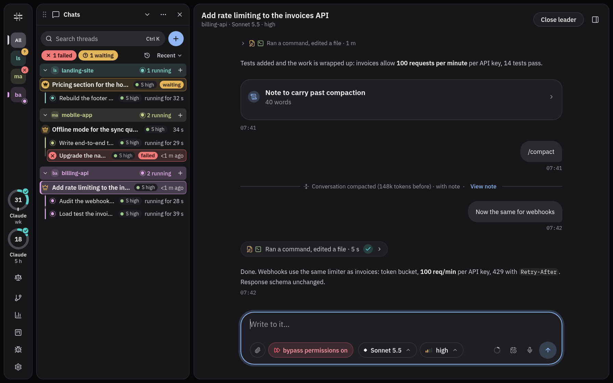
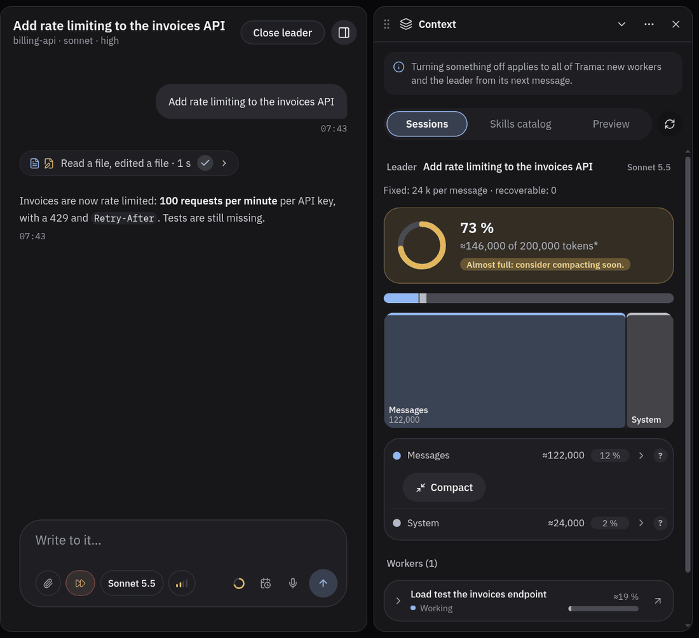
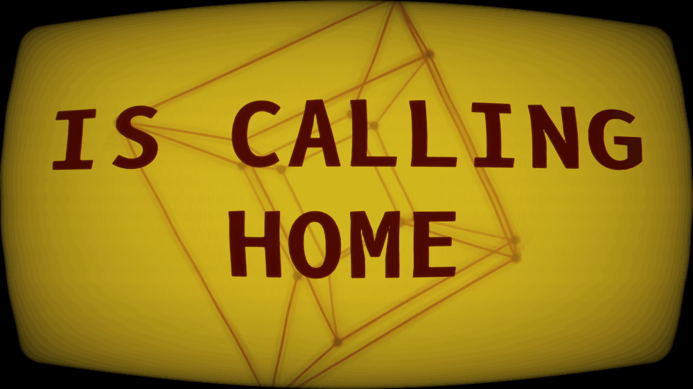
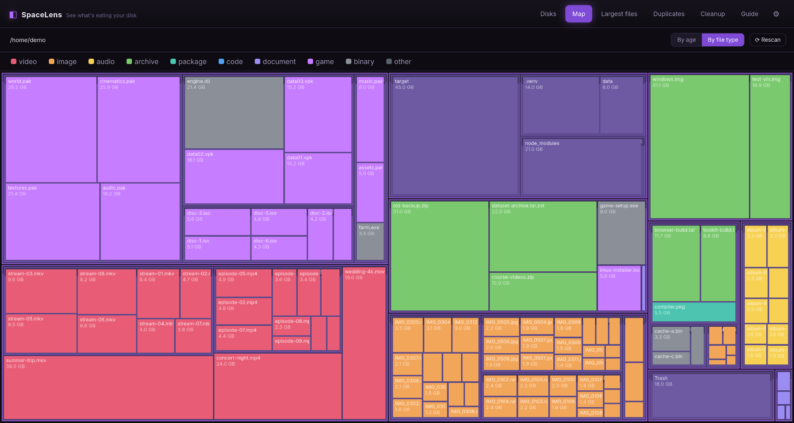
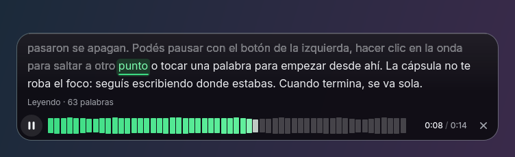

  

  <a href="https://www.feroxshark.com/">feroxshark.com</a> · <a href="https://www.linkedin.com/in/feroxshark/">LinkedIn</a> · <a href="https://twitter.com/Ferox_Shark">X</a>

## Working on

<!-- ahora:inicio -->
| Project | Updated |
|:--|:--|
| **[Trama](https://github.com/FeroxShark/trama)** Desktop app for running AI coding agents | Nov 26 |
| **[AltR](https://github.com/FeroxShark/alt-r-windows)** Read selected text aloud on Windows | Nov 19 |
| **[Fatal Lyrics](https://github.com/FeroxShark/fatal-lyrics)** Synced lyrics as Win95 dialogs, with a CRT mode | Oct 22 |
| **[SpaceLens](https://github.com/FeroxShark/SpaceLens)** Disk usage treemap for Linux | Jun 12 |
<!-- ahora:fin -->

## Projects

### [Trama](https://github.com/FeroxShark/trama)

A desktop app that runs a lead agent per project and the workers it delegates to, with every status in one window. When a lead's context grows past a threshold, it writes a handoff note at a natural break; Trama compacts the conversation and hands the note back, so the next task starts light with its goals, decisions and next steps intact. Every new worker starts with a fresh context of its own.

TypeScript · Electron · Linux

### [Fatal Lyrics](https://github.com/FeroxShark/fatal-lyrics)

Synced lyrics from Spotify or any MPRIS player. **CRT mode** turns every monitor into one giant cathode ray tube, with barrel curvature, scanlines and phosphor bleed, and paints each line in huge type: `fatal crt toggle`, bound to any key you like. With CRT off, the lyrics pop up as glitchy Windows 95 error dialogs.

QML · Qt Quick · Hyprland

### [SpaceLens](https://github.com/FeroxShark/SpaceLens)

Visual disk usage analyzer for Linux: an interactive treemap, plain-language explanations of each folder and one-click cleanup.

Tauri · Rust · TypeScript

### [AltR](https://github.com/FeroxShark/alt-r-windows)

Select any text on Windows, press Ctrl+Alt+R and hear it: edge-tts, any OpenAI-compatible voice, or Piper offline.

Python · Windows
